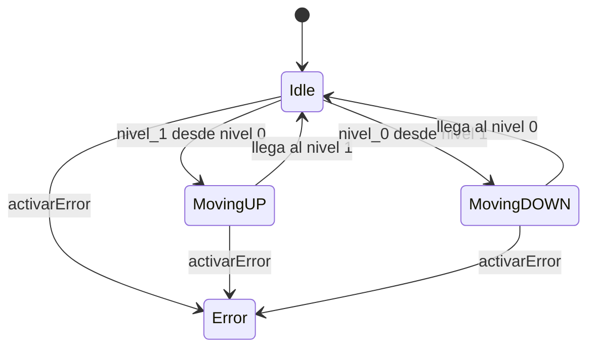

# Solución: Máquina de estados del Halo de Vigo

## 1. Objetivo

El objetivo es representar el funcionamiento del mecanismo del Halo de Vigo mediante una máquina de estados programada en Kotlin.

La máquina puede estar en reposo, subiendo, bajando o en estado de error.

## 2. Estados

Se ha creado el enumerado `EstadoHalo`, que contiene los cuatro estados:

| Estado | Descripción |
|---|---|
| `Idle` | El mecanismo está parado en un nivel. |
| `MovingUP` | El mecanismo está subiendo al nivel 1. |
| `MovingDOWN` | El mecanismo está bajando al nivel 0. |
| `Error` | El mecanismo está en estado de error. |

## 3. Variables

La variable `nivel_actual` es de tipo `Int` y comienza con el valor `0`.

| Valor | Significado |
|---:|---|
| `0` | Avenida García Barbón. |
| `1` | Plaza de Compostela. |
| `2` | El mecanismo está en movimiento. |
| `-1` | El mecanismo está en error. |

La variable `estado_actual` guarda el estado actual de la máquina utilizando el enumerado `EstadoHalo`.

## 4. Botonera y transiciones

- `nivel_0()`: solicita bajar cuando la máquina está en `Idle` y en el nivel 1.
- `nivel_1()`: solicita subir cuando la máquina está en `Idle` y en el nivel 0.
- `gestionarEstado()`: finaliza el movimiento y establece el nivel de destino.
- `activarError()`: cambia el estado a `Error` y establece `nivel_actual` en `-1`.

No se permiten nuevas solicitudes de movimiento mientras la máquina está en movimiento o en estado de error.

## 5. Diagrama de estados

Cuando comienza un movimiento, `nivel_actual` toma el valor `2`. Al terminar, vuelve a ser `0` o `1`. En caso de error, toma el valor `-1`.

## 6. Tests unitarios

Se han creado tests con JUnit 5 para comprobar:

- El estado y nivel iniciales.
- La subida y la bajada.
- La llegada a los dos niveles.
- Los botones pulsados desde un nivel incorrecto.
- La imposibilidad de iniciar otro movimiento mientras se mueve.
- La entrada en estado de error y el bloqueo de movimientos.
- Un recorrido completo de subida y bajada.

Se utiliza `@BeforeEach` para reiniciar las variables antes de cada test y evitar que un test dependa del resultado de otro.

## 7. Conclusión

La implementación representa los movimientos del mecanismo mediante estados y transiciones. Los tests permiten verificar que las acciones producen los estados y niveles esperados.

